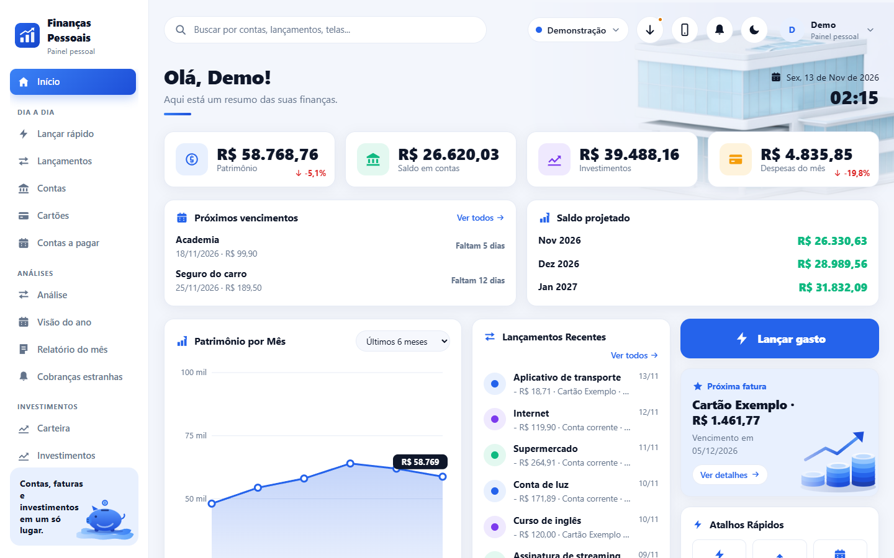
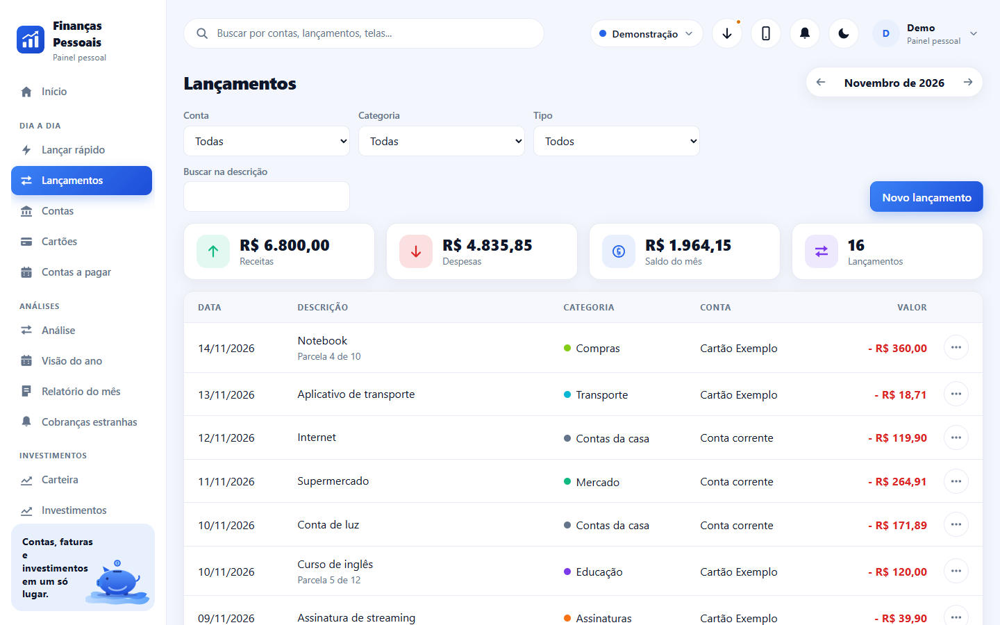
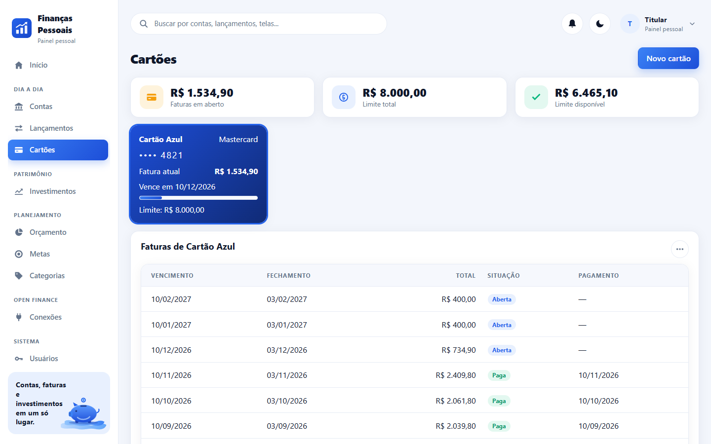
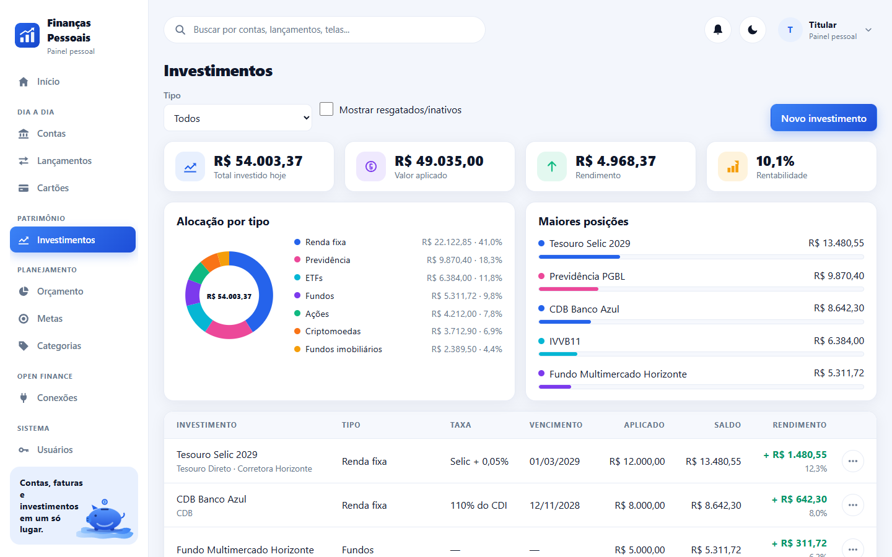
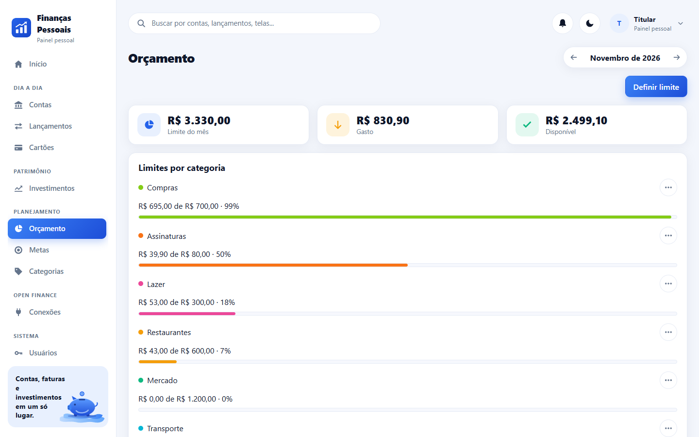
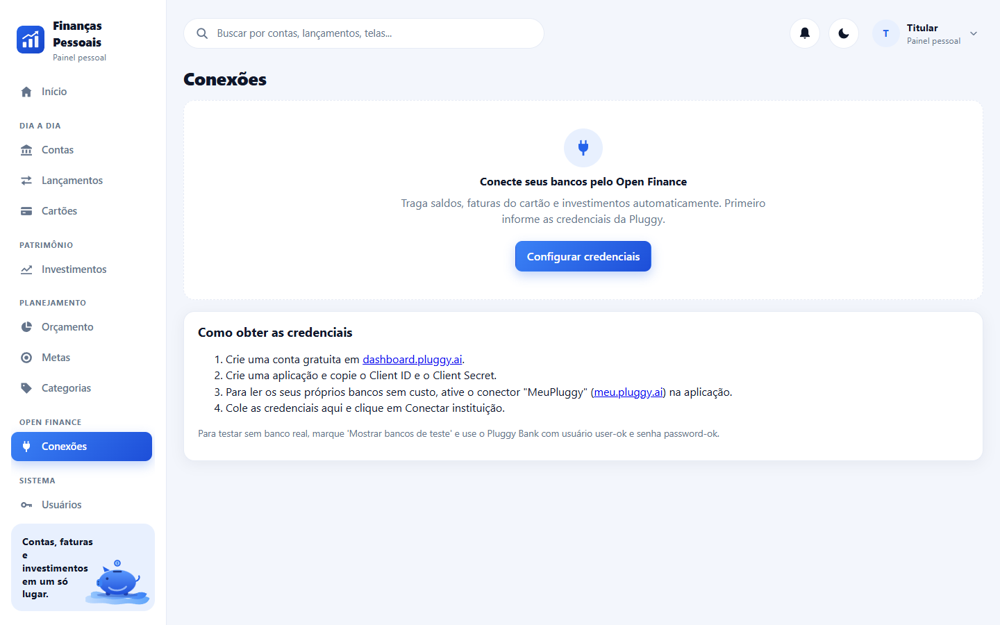
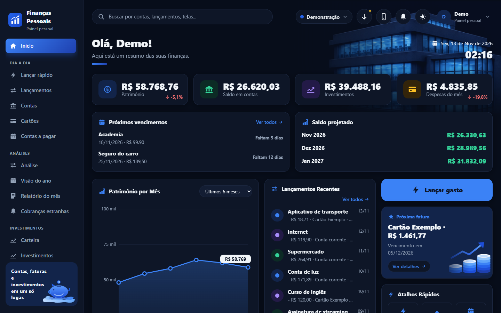

<p align="center"></p>

<h1 align="center">Sistema Financeiro Pessoal</h1>

<p align="center">Contas, faturas do cartão e investimentos em um único app web, com dados trazidos do banco pelo Open Finance.</p>

<p align="center">
  
  
  
  
  
  
</p>

<p align="center"></p>

## Sumário

- [Visão geral](#visão-geral)
- [Funcionalidades](#funcionalidades)
- [Telas](#telas)
- [Instalação rápida](#instalação-rápida)
- [Primeiro acesso](#primeiro-acesso)
- [Open Finance](#open-finance)
- [Configuração](#configuração)
- [Arquitetura](#arquitetura)
- [Desenvolvimento](#desenvolvimento)
- [Origem](#origem)
- [Segurança](#segurança)
- [Licença](#licença)

## Visão geral

O Sistema Financeiro Pessoal reúne, num painel só, o saldo das contas, as faturas do cartão de crédito, a carteira de investimentos, o orçamento do mês e as metas. Os dados podem ser digitados à mão ou chegar sozinhos do banco, do cartão e da corretora pelo **Open Finance**, por meio da [Pluggy](https://pluggy.ai). Funciona no computador e no celular, com tema claro e escuro.

Você instala no seu computador (ou num servidor seu) com Docker. Os dados ficam no seu banco PostgreSQL.

## Funcionalidades

**Open Finance**

- Conexão com bancos, cartões e corretoras pelo widget da Pluggy. A senha do banco é digitada na janela da Pluggy e nunca passa pelo sistema.
- Traz contas e saldos, cartões com limite e datas, **faturas do cartão** com cada compra e parcela, lançamentos dos últimos 12 meses e a **carteira de investimentos** com posição e movimentos.
- Sincronização ao conectar, por botão e automática a cada 6 horas. Sincronizar de novo atualiza os registros, sem duplicar.
- O que você ajusta num registro do banco é preservado: nome e cor da conta, categoria, observação e marcação de transferência do lançamento.
- Acesso somente leitura: o sistema não faz pagamentos nem transferências.

**Contas e lançamentos**

- Contas corrente, poupança, carteira e conta de investimento, com patrimônio calculado.
- Lançamentos por mês, com filtros por conta, categoria e tipo, busca na descrição e totais de receitas, despesas e saldo.
- Transferências entre contas próprias e pagamento de fatura não contam como receita nem despesa.
- Categorias com cor, criadas e editadas por você. Uma lista padrão vem pronta.

**Cartões e faturas**

- Cartões com limite, dia de fechamento e de vencimento.
- Cada compra entra na fatura certa pelo ciclo do cartão. Compras parceladas geram uma parcela por fatura.
- Detalhe da fatura com as compras, o total por categoria e o pagamento debitando de uma conta.
- Situação da fatura: aberta, fechada, paga ou atrasada.

**Investimentos**

- Renda fixa, fundos, ações, fundos imobiliários, ETFs, previdência e criptomoedas.
- Valor aplicado, saldo, rendimento e rentabilidade de cada posição e da carteira.
- Gráfico de alocação por tipo e as maiores posições.
- Movimentos de aplicação, resgate, rendimento e imposto.

**Planejamento**

- Orçamento: limite mensal por categoria, com barra de progresso e os gastos sem limite definido.
- Metas com valor alvo, valor guardado e prazo.

**Painel e sistema**

- Painel com patrimônio, saldo em contas, investimentos e despesas do mês, evolução do patrimônio em 12 meses, lançamentos recentes e a próxima fatura.
- Sino de avisos: fatura vencendo ou atrasada, orçamento estourado e conexão que precisa ser refeita.
- Busca no topo por contas, lançamentos, investimentos e telas.
- Usuários, log de atividades, identidade visual (nome, logo e cores) e envio de e-mails de recuperação de senha.

## Telas

| | |
|---|---|
|  |  |
|  |  |
|  |  |

Os dados dos prints são fictícios. O sistema é instalado vazio, só com a conta demo e as categorias padrão.

## Instalação rápida

Você precisa do [Docker Desktop](https://www.docker.com/products/docker-desktop/) instalado e aberto.

```
git clone https://github.com/marco3079/sistema-financeiro-pessoal.git
cd sistema-financeiro-pessoal
```

- Windows (PowerShell): `powershell -ExecutionPolicy Bypass -File .\instalar.ps1`
- Linux e macOS: `bash instalar.sh`

O instalador confere o Docker, cria o arquivo `.env` com segredos aleatórios e sobe os contêineres. No fim, mostra o endereço do site (padrão `http://localhost:8092`).

O passo a passo completo, com perguntas frequentes, está em [INSTALAR.md](INSTALAR.md). Para instalar com a ajuda de um assistente de IA, veja [AGENTS.md](AGENTS.md).

## Primeiro acesso

- E-mail: `demo@financas.local`
- Senha: `demo1234`

Troque a senha em **Meu perfil** logo no primeiro acesso. Depois, conecte seu banco em **Conexões** ou cadastre suas contas à mão em **Contas**.

## Open Finance

A conexão com os bancos é feita pela Pluggy, uma empresa de agregação de dados financeiros. Você precisa de um par de credenciais dela (Client ID e Client Secret):

1. Crie uma conta em [dashboard.pluggy.ai](https://dashboard.pluggy.ai) e crie uma aplicação.
2. Copie o **Client ID** e o **Client Secret** da aplicação.
3. No sistema, abra **Conexões**, clique em **Configurar credenciais** e cole os dois valores. O sistema testa as credenciais na hora e guarda o segredo cifrado.
4. Clique em **Conectar instituição**, escolha seu banco, cartão ou corretora e siga os passos na janela da Pluggy.

Ao terminar, o sistema busca contas, cartões, faturas, lançamentos e investimentos. Isso pode levar até um minuto.

**Para uso pessoal, sem custo:** a Pluggy oferece o [Meu Pluggy](https://meu.pluggy.ai), em que você conecta os seus próprios bancos pelo Open Finance e libera a leitura para a sua aplicação pelo conector "MeuPluggy". O guia está em [meu.pluggy.ai/api-guide](https://meu.pluggy.ai/api-guide). Os conectores diretos de Open Finance para aplicações comerciais são um plano pago da Pluggy.

**Para testar sem banco real:** em **Conexões**, marque **Mostrar bancos de teste** nas credenciais e conecte o **Pluggy Bank** com usuário `user-ok` e senha `password-ok`.

As credenciais também podem vir do arquivo `.env` (`PLUGGY_CLIENT_ID` e `PLUGGY_CLIENT_SECRET`).

Limites conhecidos:

- A Pluggy não informa se uma fatura foi paga. O sistema considera paga a fatura que tem pagamento registrado ou cujo vencimento já passou.
- A fatura em aberto é montada a partir do saldo do cartão e das compras ainda sem fatura fechada.
- A sincronização foi escrita a partir da documentação da Pluggy e ainda não foi validada com todos os bancos. Depois da primeira sincronização, confira saldos e faturas com o aplicativo do banco.

## Configuração

O arquivo `.env` (criado pelo instalador a partir de [.env.example](.env.example)) guarda:

| Variável | Para que serve | Padrão |
|---|---|---|
| `POSTGRES_PASSWORD` | Senha do banco | aleatória |
| `JWT_SECRET` | Segredo dos logins e da cifra dos segredos guardados no banco | aleatório |
| `ADMIN_NOME`, `ADMIN_EMAIL`, `ADMIN_SENHA` | Conta do titular criada na primeira subida | `Demo`, `demo@financas.local`, `demo1234` |
| `WEB_PORT` | Porta do site | `8092` |
| `API_PORT` | Porta da API (só neste computador) | `3092` |
| `DB_PORT` | Porta do banco (só neste computador) | `5434` |
| `PLUGGY_CLIENT_ID`, `PLUGGY_CLIENT_SECRET` | Credenciais do Open Finance (opcional; também dá para informar na tela) | vazias |
| `PLUGGY_SANDBOX` | `true` mostra os bancos de teste da Pluggy | `false` |

Se você trocar o `JWT_SECRET`, os segredos cifrados no banco (senha do e-mail e Client Secret da Pluggy) deixam de abrir e precisam ser digitados de novo.

Nome, logo, cores e conta de e-mail ficam em **Configurações**, dentro do sistema.

## Arquitetura

Três contêineres: `db` (PostgreSQL 16), `api` (Node 20, Express, Prisma) e `web` (site React servido pelo nginx, que também encaminha `/api`).

```
server/
  prisma/schema.prisma            modelo de dados
  src/lib/financas.ts             regras de saldo, fatura e patrimônio
  src/lib/pluggy.ts               cliente HTTP da Pluggy
  src/lib/sincronizacao.ts        importação do Open Finance
  src/modules/<modulo>/routes.ts  rotas de cada módulo
client/
  src/layout/                     casca (menu, topo), painel e login
  src/ui/                         componentes e estilos
  src/modules/<modulo>/           telas de cada módulo
```

Detalhes em [docs/ARQUITETURA.md](docs/ARQUITETURA.md) e a lista de rotas em [docs/API.md](docs/API.md).

## Desenvolvimento

```
cd server && npm install && npx tsc --noEmit
cd client && npm install && npx tsc --noEmit && npx vite build
```

Para rodar fora do Docker: suba só o banco (`docker compose up -d db`), copie `server/.env.example` para `server/.env`, rode `npx prisma db push` e `npm run dev` em `server/`, e `npm run dev` em `client/`.

Como contribuir: [CONTRIBUTING.md](CONTRIBUTING.md).

## Origem

Este projeto usa a mesma estrutura e a mesma interface do [Sistema Escolar](https://github.com/marco3079/sistema-escolar) e do [Sistema de Restaurante](https://github.com/marco3079/sistema-restaurante): a casca (menu lateral, topo, painel, login), os componentes, o log de atividades, os usuários e as configurações vêm de lá. Os módulos financeiros e a integração com o Open Finance são novos.

## Segurança

Veja [SECURITY.md](SECURITY.md). Em resumo: troque a senha padrão, não exponha o sistema à internet sem HTTPS e lembre que ele guarda dados financeiros seus.

## Licença

[MIT](LICENSE).
