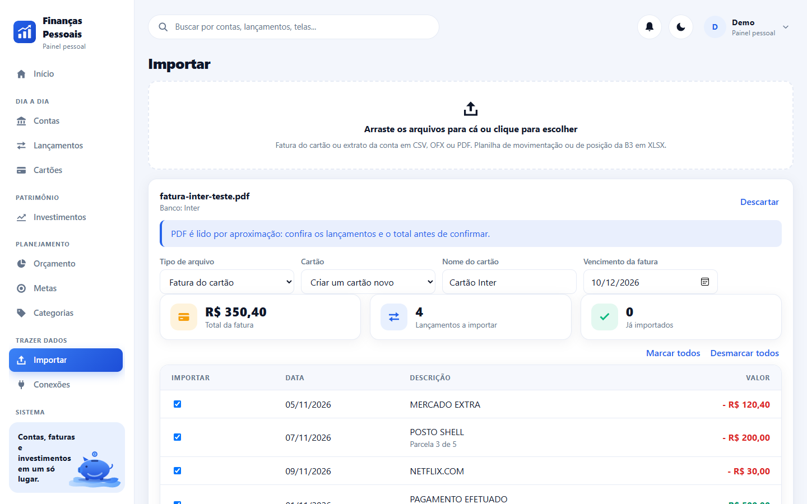

<p align="center"></p>

<h1 align="center">Sistema Financeiro Pessoal</h1>

<p align="center">Contas, faturas do cartão e investimentos em um único app web. Você envia o arquivo do banco e a planilha da B3, e o sistema organiza.</p>

<p align="center">
  
  
  
  
  
  
</p>

<p align="center"></p>

## Sumário

- [Visão geral](#visão-geral)
- [Funcionalidades](#funcionalidades)
- [Telas](#telas)
- [Instalação rápida](#instalação-rápida)
- [Primeiro acesso](#primeiro-acesso)
- [Importar arquivos](#importar-arquivos)
- [Drive: os mesmos dados em mais de um computador](#drive-os-mesmos-dados-em-mais-de-um-computador)
- [Conectar IA (MCP)](#conectar-ia-mcp)
- [Atualizar o sistema](#atualizar-o-sistema)
- [Verificação em duas etapas](#verificação-em-duas-etapas)
- [Restaurar uma cópia do banco](#restaurar-uma-cópia-do-banco)
- [Abrir no celular](#abrir-no-celular)
- [Rendimento e índices](#rendimento-e-índices)
- [Open Finance (opcional)](#open-finance-opcional)
- [Configuração](#configuração)
- [Arquitetura](#arquitetura)
- [Desenvolvimento](#desenvolvimento)
- [Origem](#origem)
- [Segurança](#segurança)
- [Licença](#licença)

## Visão geral

O Sistema Financeiro Pessoal reúne, num painel só, o saldo das contas, as faturas do cartão de crédito, a carteira de investimentos, o orçamento do mês e as metas. Os dados entram de três jeitos: **importando o arquivo** que o banco exporta (fatura e extrato em CSV, OFX ou PDF) e a planilha da Área do Investidor da B3; digitando à mão; ou, para quem tiver acesso, pelo Open Finance da [Pluggy](https://pluggy.ai). Funciona no computador e no celular, com tema claro e escuro.

Você instala no seu computador (ou num servidor seu) com Docker. Os dados ficam no seu banco PostgreSQL.

## Funcionalidades

**Importação de arquivos**

- Fatura do cartão e extrato da conta em **CSV, OFX ou PDF**: o sistema detecta o banco, o mês da fatura, as parcelas e o pagamento da fatura anterior, e mostra uma prévia antes de gravar.
- Formatos conferidos com arquivos reais: CSV de fatura do Nubank e da XP. Os demais bancos passam pelo leitor genérico (colunas de data, descrição e valor; OFX; PDF por aproximação).
- Reenviar o mesmo arquivo não duplica lançamentos.
- Histórico dos arquivos importados: ver o que cada arquivo trouxe, editar ou excluir lançamentos dali mesmo e remover a importação inteira (os lançamentos saem e o saldo e a fatura são acertados).
- Categoria automática pela descrição e pelo que você já classificou antes.
- Movimentos entre contas próprias entram como transferência e ficam fora dos gastos: pagamento de fatura, aplicação e resgate, e o Pix pago no crédito (o crédito que o cartão põe na conta e a saída por Pix de mesmo valor; o gasto conta na fatura).
- **Planilha da B3** (movimentação ou posição, em XLSX): monta a carteira com quantidade e custo médio, importa compras, vendas e proventos, e traz desmarcados os ativos que parecem ter saído da carteira.
- **Cotações automáticas** de ações, fundos imobiliários e ETFs pela brapi.dev, a cada 8 horas.
- O arquivo é lido no navegador; o servidor recebe só o conteúdo e não guarda o arquivo.

**Perfis financeiros**

- Um login, vários perfis ("Pessoal", "Empresa", "Casal"): cada um com as próprias contas, cartões, faturas, investimentos, categorias, orçamento e metas.
- A troca é feita pelo seletor no topo; os perfis são criados, renomeados e apagados em **Perfis financeiros**.

**Análise e rendimento**

- **Análise**: receitas e gastos mês a mês, por categoria e por estabelecimento, gastos que se repetem e sugestões calculadas a partir dos seus dados, separadas em gastos, receitas e investimentos.
- **Rendimento**: quanto a carteira rendeu (valorização mais proventos) e quanto os mesmos aportes, nas mesmas datas, teriam rendido na Selic, no IPCA, no Ibovespa e no IFIX.
- Renda fixa sem cotação tem o saldo corrigido pela taxa do título ("110% do CDI", "IPCA + 6%", "12% a.a.").
- Projeção da carteira para 12 meses, supondo que cada classe repita o que o seu índice rendeu nos últimos 12.
- **Próximas faturas**: as parcelas que ainda não foram cobradas, distribuídas mês a mês.

**Carteira**

- **Resumo**: patrimônio, desempenho do mês contra CDI e Ibovespa, distribuição por mercado e por instituição, histórico do patrimônio e ganho de capital mês a mês.
- **Análises**: rentabilidade por dia, por mês e por ano contra CDI, Ibovespa, IPCA e IFIX, com o pior e o melhor de cada um; filtro por renda variável, fundos e renda fixa.
- **Relatório**: rentabilidade por período, estatísticas, divisão por mercado e por instituição, tabela ano × meses e todos os ativos com rentabilidade acumulada e % do CDI. Imprime ou salva em PDF.
- **Proventos**: histórico, mapa de calor mensal por ativo, distribuição e rendimento sobre o custo; agenda com o que foi recebido e uma estimativa dos próximos 12 meses.
- Cotações e preços históricos vêm do Yahoo Finance, sem cadastro (o token da brapi.dev continua opcional).

**Drive**

- Os dados acompanham uma pasta sincronizada (Google Drive, OneDrive, Dropbox) para usar o sistema em mais de um computador.

**Conectar IA (MCP)**

- Servidor MCP embutido: assistentes como Claude, ChatGPT, Cursor e VS Code consultam seus dados para responder perguntas ("quanto gastei com mercado este ano?").
- Cada chave de acesso é "só consulta" ou "consulta e lança", vale para um perfil financeiro e pode ser apagada a qualquer momento.

**Dia a dia**

- **Lançar rápido**: tela para o celular, com valor, categoria e conta em poucos toques e "Desfazer".
- **Contas a pagar e a receber**: contas fixas e faturas no calendário do mês, com marcação de pago, e o **fluxo de caixa** projetado para os próximos meses (contas fixas, faturas e parcelas previstas).
- **Cobranças estranhas**: indícios de cobrança em dobro, assinatura que subiu de preço, parcela além da última e assinatura nova.
- **Relatório do mês** em uma página, para imprimir ou salvar em PDF.
- **Divisão de gastos**: quanto cada pessoa deve de um lançamento, com marcação de recebido e resumo para copiar.
- **Conciliação dos cartões**: compara a dívida registrada com as faturas não pagas e o total de cada fatura com os lançamentos, e corrige os totais.

**Menos trabalho manual**

- **Regras de categoria** ("contém UBER" → Transporte), aplicadas na importação e, com prévia, aos lançamentos que já existem. O mesmo reprocessamento marca como transferência o Pix pago no crédito.
- **Pasta de entrada**: arquivos CSV e OFX colocados em `financas-pessoais/entrada`, na pasta do Drive, são importados sozinhos e movidos para `importados` ou `com-erro`.
- **Planilha de investimentos**: CDB, fundos e outros ativos de fora da B3 por um CSV modelo.

**Investimentos, além da carteira**

- **Carteira-alvo**: percentual desejado por classe e a distância até ele (só mostra o desvio).
- **Imposto de renda**: vendas por mês com o resultado pelo custo médio, posição em 31/12 e proventos do ano. É um apoio à declaração: não calcula o imposto a pagar.

**Segurança**

- **Verificação em duas etapas** no login, com aplicativo autenticador e códigos de recuperação.
- **Cópias do banco**: lista das cópias feitas antes de cada atualização, com a opção de restaurar uma delas.

**Atualização**

- A tela **Atualização** compara a versão instalada com o último commit do repositório no GitHub, mostra o que há de novo e atualiza com um clique, guardando antes uma cópia do banco de dados.

**Abrir no celular**

- O botão com o ícone de celular, no topo, mostra um QR code com o endereço deste computador na rede.

**Open Finance (opcional)**

- Conexão com bancos, cartões e corretoras pelo widget da Pluggy. A senha do banco é digitada na janela da Pluggy e nunca passa pelo sistema.
- Traz contas e saldos, cartões com limite e datas, **faturas do cartão** com cada compra e parcela, lançamentos dos últimos 12 meses e a **carteira de investimentos** com posição e movimentos.
- Sincronização ao conectar, por botão e automática a cada 6 horas. Sincronizar de novo atualiza os registros, sem duplicar.
- O que você ajusta num registro do banco é preservado: nome e cor da conta, categoria, observação e marcação de transferência do lançamento.
- Acesso somente leitura: o sistema não faz pagamentos nem transferências.

**Contas e lançamentos**

- Contas corrente, poupança, carteira e conta de investimento, com patrimônio calculado.
- Lançamentos por mês, com filtros por conta, categoria e tipo, busca na descrição e totais de receitas, despesas e saldo.
- Transferências entre contas próprias e pagamento de fatura não contam como receita nem despesa.
- Categorias com cor, criadas e editadas por você. Uma lista padrão vem pronta.

**Cartões e faturas**

- Cartões com limite, dia de fechamento e de vencimento.
- Cada compra entra na fatura certa pelo ciclo do cartão. Compras parceladas geram uma parcela por fatura.
- Detalhe da fatura com as compras, o total por categoria e o pagamento debitando de uma conta.
- Situação da fatura: aberta, fechada, paga ou atrasada.

**Investimentos**

- Renda fixa, fundos, ações, fundos imobiliários, ETFs, previdência e criptomoedas.
- Valor aplicado, saldo, rendimento e rentabilidade de cada posição e da carteira.
- Gráfico de alocação por tipo e as maiores posições.
- Movimentos de aplicação, resgate, rendimento e imposto.

**Planejamento**

- Orçamento: limite mensal por categoria, com barra de progresso e os gastos sem limite definido.
- Metas com valor alvo, valor guardado e prazo.

**Painel e sistema**

- Painel com patrimônio, saldo em contas, investimentos e despesas do mês, evolução do patrimônio em 12 meses, lançamentos recentes e a próxima fatura.
- Sino de avisos: fatura vencendo ou atrasada, orçamento estourado e conexão que precisa ser refeita.
- Busca no topo por contas, lançamentos, investimentos e telas.
- Usuários, log de atividades, identidade visual (nome, logo e cores) e envio de e-mails de recuperação de senha.

## Telas

| | |
|---|---|
|  |  |
|  |  |
|  |  |

Os dados dos prints são fictícios. O sistema é instalado vazio, só com a conta demo e as categorias padrão.

## Instalação rápida

Você precisa do [Docker Desktop](https://www.docker.com/products/docker-desktop/) instalado e aberto.

```
git clone https://github.com/marco3079/sistema-financeiro-pessoal.git
cd sistema-financeiro-pessoal
```

- Windows (PowerShell): `powershell -ExecutionPolicy Bypass -File .\instalar.ps1`
- Linux e macOS: `bash instalar.sh`

O instalador confere o Docker, cria o arquivo `.env` com segredos aleatórios e sobe os contêineres. No fim, mostra o endereço do site (padrão `http://localhost:8092`).

O passo a passo completo, com perguntas frequentes, está em [INSTALAR.md](INSTALAR.md). Para instalar com a ajuda de um assistente de IA, veja [AGENTS.md](AGENTS.md).

## Primeiro acesso

- E-mail: `demo@financas.local`
- Senha: `demo1234`

Troque a senha em **Meu perfil** logo no primeiro acesso. Depois, envie a fatura do cartão e a planilha da B3 em **Importar**, ou cadastre suas contas à mão em **Contas**.

## Importar arquivos

Abra **Importar** e arraste os arquivos (pode enviar vários de uma vez).

**Fatura do cartão e extrato da conta**

1. No aplicativo ou no site do banco, exporte a fatura (ou o extrato) em CSV ou OFX. Se só houver PDF, envie o PDF.
2. O sistema mostra o banco detectado, o vencimento, o total e cada lançamento. Confira, escolha o cartão (ou deixe criar um) e confirme.
3. Fatura com vencimento já passado entra como paga; as demais ficam em aberto e somam na dívida do cartão.

O nome do arquivo ajuda: `Nubank_2026-11-08.csv` já diz o banco e o vencimento. PDF é lido por aproximação e não funciona com PDF protegido por senha nem com imagem digitalizada.

**Investimentos (B3)**

A B3 não oferece API para pessoa física (a API da Área do Investidor é vendida só a empresas), mas deixa baixar planilhas:

1. Entre em [investidor.b3.com.br](https://www.investidor.b3.com.br), abra **Extratos > Movimentação**, filtre o período mais longo possível e baixe em Excel.
2. Envie o XLSX em **Importar**. O sistema calcula a posição de cada ativo somando compras, vendas, desdobramentos e bonificações, e importa os proventos.
3. Confira a lista: ativos sem movimento há mais de um ano, ou cuja quantidade não bate com o último provento, vêm desmarcados.

A planilha de **Posição** também é aceita (carteira do dia, com o valor atualizado). O leitor dela foi escrito pelo formato conhecido e ainda não foi conferido com um arquivo real.

**Cotações**

Crie um token gratuito em [brapi.dev](https://brapi.dev) e cole no cartão **Cotações automáticas** da tela Importar (ou em `BRAPI_TOKEN` no `.env`). O saldo de cada ação, fundo imobiliário e ETF passa a ser quantidade × preço, atualizado a cada 8 horas. Renda fixa e Tesouro não têm cotação: o saldo fica o que você informar.

## Drive: os mesmos dados em mais de um computador

O sistema guarda em uma pasta do seu Drive uma cópia completa dos dados e a mantém atualizada. No outro computador, você instala o sistema e escolhe a mesma pasta: os dados aparecem sozinhos.

1. Instale o programa do Drive (Google Drive para computador, OneDrive, Dropbox) e confira que a pasta aparece no Explorador de Arquivos.
2. Na pasta do sistema, clique com o botão direito em `conectar-drive.ps1` e escolha **Executar com o PowerShell**. Escolha uma pasta dentro do Drive. No Linux ou no Mac, escreva o caminho em `PASTA_DRIVE` no `.env` e rode `docker compose up -d`.
3. Abra a tela **Drive** para acompanhar. Repita no outro computador com a mesma pasta.

Como funciona: cada computador continua com o próprio banco de dados. A cada 20 segundos o sistema confere a pasta: o que você alterou é gravado nela; o que o outro computador gravou é carregado. Um banco de dados "vivo" dentro de pasta sincronizada corromperia com dois computadores gravando, por isso a pasta guarda uma fotografia completa (`financas-pessoais/dados.json.gz`) e não o banco em si.

Limites que você precisa conhecer:

- O programa do Drive leva alguns segundos para subir e baixar o arquivo. Depois de alterar algo, espere a tela Drive mostrar **Tudo sincronizado** antes de usar o outro computador.
- Se os dois computadores alterarem dados no mesmo intervalo, vale a alteração mais recente inteira (as mudanças não são misturadas). A outra versão fica guardada na pasta como `conflito-...`, sem ser apagada.
- No Google Drive, use o modo **Espelhar arquivos** (ou uma pasta que exista de verdade no disco): o Docker pode não conseguir abrir a unidade virtual do modo de streaming.
- O arquivo da pasta tem todos os seus dados financeiros e não é cifrado: a proteção é a da sua conta do Drive.
- Para os tokens gravados (cotações, Open Finance) funcionarem nos dois computadores, use o mesmo `JWT_SECRET` no `.env` dos dois.

## Conectar IA (MCP)

O sistema fala o [Model Context Protocol](https://modelcontextprotocol.io) em `/api/mcp` (transporte Streamable HTTP, sem sessão). Em **Conectar IA** você cria uma chave e copia a configuração pronta para cada aplicativo.

Ferramentas oferecidas:

| Ferramenta | O que faz |
|---|---|
| `visao_geral` | patrimônio, saldo das contas e dívida dos cartões |
| `listar_lancamentos` | receitas e despesas com filtros de período, texto, conta, categoria e tipo |
| `listar_categorias` | categorias com os ids |
| `analise_de_gastos` | gastos por mês, categoria e estabelecimento, recorrentes e sugestões |
| `cartoes_e_faturas` | cartões, faturas e a previsão das próximas com as parcelas a vencer |
| `investimentos` | posição de cada investimento |
| `carteira` | rentabilidade por período contra CDI, Ibovespa, IPCA e IFIX |
| `proventos` | proventos recebidos e a agenda estimada |
| `comparar_com_indices` | os mesmos aportes aplicados em cada índice |
| `orcamento_e_metas` | limites do mês e andamento das metas |
| `criar_lancamento` | registra uma receita ou despesa (só chave "consulta e lança") |
| `categorizar_lancamento` | muda a categoria de um lançamento (só chave "consulta e lança") |

Nenhuma ferramenta apaga dados.

Exemplos (troque `SUA_CHAVE` pela chave criada na tela):

```bash
claude mcp add --transport http financas http://localhost:8092/api/mcp --header "Authorization: Bearer SUA_CHAVE"
```

Cursor (`.cursor/mcp.json`):

```json
{ "mcpServers": { "financas": { "url": "http://localhost:8092/api/mcp", "headers": { "Authorization": "Bearer SUA_CHAVE" } } } }
```

A tela traz também os exemplos do Claude Desktop (pela ponte `mcp-remote`) e do VS Code. O caminho dos menus muda entre as versões de cada aplicativo; o que importa é o endereço e o cabeçalho `Authorization`.

O que você precisa saber:

- **O que a IA consulta sai do seu computador.** A resposta de cada ferramenta é enviada ao provedor do assistente (Anthropic, OpenAI...).
- **Aplicativos de navegador (ChatGPT, Claude na web) não alcançam o localhost.** Para usá-los, o sistema precisa estar publicado na internet com HTTPS; nesse caso a chave pode ir no fim do endereço (`https://seu-endereco/api/mcp/SUA_CHAVE`), e esse endereço passa a valer como senha.
- A chave aparece uma vez, ao ser criada; o banco guarda só o hash. Há limite de 120 chamadas por minuto por chave.
- Testado no nível do protocolo (inicialização, lista e chamada de todas as ferramentas). Ainda não foi conferido dentro de cada aplicativo de IA.

## Atualizar o sistema

O sistema roda dentro do Docker e não consegue trocar o próprio programa; quem atualiza é um script no computador. Há dois jeitos:

- **Pelo botão da tela (Windows)**: rode uma vez `powershell -ExecutionPolicy Bypass -File atualizar.ps1 -Instalar`. Isso cria uma tarefa do Windows (`FinancasPessoais-Atualizador`) que fica esperando. Depois, quando houver versão nova, aparece um botão no topo; em **Atualização**, clique em **Atualizar agora**.
- **Pelo script**: dê dois cliques em `atualizar.ps1` (Windows) ou rode `sh atualizar.sh` (Linux e Mac). No Linux e no Mac a tela só avisa que há versão nova.

O que a atualização faz, nesta ordem: guarda uma cópia do banco em `backups/` (ficam as 5 mais recentes), roda `git pull --ff-only` e reconstrói os contêineres. Seus dados não são apagados. Se você alterou arquivos do sistema e eles conflitarem com a versão nova, a atualização para sem apagar nada e mostra o erro na tela.

A tarefa só sabe fazer isso: o servidor grava um arquivo de pedido em `atualizacao/` e a tarefa responde atualizando a partir do repositório de origem; nenhum comando vem da tela. Para remover: `atualizar.ps1 -Desinstalar`. Para a tela saber qual versão está instalada, o repositório precisa ser público no GitHub.

## Verificação em duas etapas

Em **Segurança**, clique em **Ativar**, leia o QR code com um aplicativo autenticador (Google Authenticator, Authy, Microsoft Authenticator) e digite o código de 6 dígitos. O sistema mostra 8 códigos de recuperação uma única vez: guarde-os fora do computador. A partir daí, o login pede a senha e o código.

- Cada código de recuperação vale uma vez.
- Perdeu o aparelho e os códigos: ponha `DESATIVAR_2FA=true` no `.env`, rode `docker compose up -d`, entre só com a senha, desative a verificação na tela e volte a variável para `false`.
- O segredo fica cifrado com uma chave derivada do `JWT_SECRET`. Se o `JWT_SECRET` mudar (ou for diferente em outro computador que receba os dados pelo Drive), o segredo não pode ser lido e o login volta a pedir só a senha. Defina um `JWT_SECRET` próprio e igual nos seus computadores.
- As chaves de IA (MCP) não passam pelo segundo passo: elas são a própria credencial.

## Restaurar uma cópia do banco

Em **Atualização > Cópias do banco de dados**, escolha a cópia e confirme digitando RESTAURAR. O atualizador guarda primeiro o estado atual, depois troca todos os dados pelos da cópia, em uma única transação (se algo falhar, nada muda). Sem o atualizador ligado: `powershell -ExecutionPolicy Bypass -File atualizar.ps1 -Restaurar financas-AAAAMMDD-HHMMSS.sql`. Com o Drive ligado, o banco restaurado passa a valer como a alteração mais recente deste computador.

## Abrir no celular

Com o celular na mesma rede Wi-Fi do computador, clique no ícone de celular no topo e aponte a câmera para o QR code.

O endereço usado é, nesta ordem: o que você digitar no próprio popup; `ENDERECO_REDE` do `.env` (o IP do computador ou um nome como `financas-pessoais.local`); ou o nome do computador seguido de `.local`, que o Windows anuncia na rede e os celulares atuais encontram sozinhos. Um nome próprio como `financas-pessoais.local` só funciona se a sua rede resolver esse nome (no roteador ou com um serviço mDNS); sem isso, use o IP.

Se o celular não abrir, libere a porta `8092` no firewall do computador. O acesso é por HTTP, só para a rede de casa: não exponha essa porta à internet.

## Rendimento e índices

A tela **Rendimento** busca os índices em fontes públicas, sem cadastro: Selic e IPCA na API de séries do Banco Central; Ibovespa e IFIX nas estatísticas históricas da B3. A primeira consulta baixa o histórico desde o ano do seu movimento mais antigo e depois atualiza a cada 12 horas.

- **Comparação**: cada aplicação, resgate e provento é repetido no índice na mesma data. O resultado diz quanto você teria hoje se o dinheiro tivesse seguido o índice.
- **Ao ano**: taxa interna de retorno, que leva em conta quando cada valor entrou e saiu.
- **Renda fixa**: escreva a taxa no cadastro do título. O saldo é uma estimativa bruta pela taxa (sem imposto de renda nem marcação a mercado) e substitui o saldo digitado.
- **Projeção**: é uma conta, não uma previsão. Rendimento passado não garante rendimento futuro.

A tela **Carteira** usa outra conta, a rentabilidade ponderada pelo tempo: em cada dia, a variação do valor dos ativos mais os proventos, sem o efeito de aplicar ou resgatar. Por isso os percentuais das duas telas não são iguais. O histórico usa a quantidade de cada dia, reconstruída pelos movimentos, e o fechamento do Yahoo Finance; desdobramentos antigos são ajustados por aproximação.

## Open Finance (opcional)

Para puxar dados reais, a Pluggy exige uma conta com acesso de produção (contas de teste só conectam o banco fictício). Se você tiver esse acesso, a tela **Conexões** continua disponível.

A conexão com os bancos é feita pela Pluggy, uma empresa de agregação de dados financeiros. Você precisa de um par de credenciais dela (Client ID e Client Secret):

1. Crie uma conta em [dashboard.pluggy.ai](https://dashboard.pluggy.ai) e crie uma aplicação.
2. Copie o **Client ID** e o **Client Secret** da aplicação.
3. No sistema, abra **Conexões**, clique em **Configurar credenciais** e cole os dois valores. O sistema testa as credenciais na hora e guarda o segredo cifrado.
4. Clique em **Conectar instituição**, escolha seu banco, cartão ou corretora e siga os passos na janela da Pluggy.

Ao terminar, o sistema busca contas, cartões, faturas, lançamentos e investimentos. Isso pode levar até um minuto.

**Para uso pessoal, sem custo:** a Pluggy oferece o [Meu Pluggy](https://meu.pluggy.ai), em que você conecta os seus próprios bancos pelo Open Finance e libera a leitura para a sua aplicação pelo conector "MeuPluggy". O guia está em [meu.pluggy.ai/api-guide](https://meu.pluggy.ai/api-guide). Os conectores diretos de Open Finance para aplicações comerciais são um plano pago da Pluggy.

**Para testar sem banco real:** em **Conexões**, marque **Mostrar bancos de teste** nas credenciais e conecte o **Pluggy Bank** com usuário `user-ok` e senha `password-ok`.

As credenciais também podem vir do arquivo `.env` (`PLUGGY_CLIENT_ID` e `PLUGGY_CLIENT_SECRET`).

Limites conhecidos:

- A Pluggy não informa se uma fatura foi paga. O sistema considera paga a fatura que tem pagamento registrado ou cujo vencimento já passou.
- A fatura em aberto é montada a partir do saldo do cartão e das compras ainda sem fatura fechada.
- A sincronização foi escrita a partir da documentação da Pluggy e ainda não foi validada com todos os bancos. Depois da primeira sincronização, confira saldos e faturas com o aplicativo do banco.

## Configuração

O arquivo `.env` (criado pelo instalador a partir de [.env.example](.env.example)) guarda:

| Variável | Para que serve | Padrão |
|---|---|---|
| `POSTGRES_PASSWORD` | Senha do banco | aleatória |
| `JWT_SECRET` | Segredo dos logins e da cifra dos segredos guardados no banco | aleatório |
| `ADMIN_NOME`, `ADMIN_EMAIL`, `ADMIN_SENHA` | Conta do titular criada na primeira subida | `Demo`, `demo@financas.local`, `demo1234` |
| `WEB_PORT` | Porta do site | `8092` |
| `API_PORT` | Porta da API (só neste computador) | `3092` |
| `DB_PORT` | Porta do banco (só neste computador) | `5434` |
| `DESATIVAR_2FA` | `true` ignora a verificação em duas etapas (emergência) | `false` |
| `PASTA_DRIVE` | Pasta sincronizada que guarda os dados (escolhida pelo `conectar-drive.ps1`) | vazio (desligado) |
| `ENDERECO_REDE` | Endereço do computador na rede para o QR code (IP ou nome `.local`) | nome do computador |
| `BRAPI_TOKEN` | Token das cotações (opcional; também dá para informar na tela) | vazio |
| `PLUGGY_CLIENT_ID`, `PLUGGY_CLIENT_SECRET` | Credenciais do Open Finance (opcional; também dá para informar na tela) | vazias |
| `PLUGGY_SANDBOX` | `true` mostra os bancos de teste da Pluggy | `false` |

Se você trocar o `JWT_SECRET`, os segredos cifrados no banco (senha do e-mail e Client Secret da Pluggy) deixam de abrir e precisam ser digitados de novo.

Nome, logo, cores e conta de e-mail ficam em **Configurações**, dentro do sistema.

## Arquitetura

Três contêineres: `db` (PostgreSQL 16), `api` (Node 20, Express, Prisma) e `web` (site React servido pelo nginx, que também encaminha `/api`).

```
server/
  prisma/schema.prisma            modelo de dados
  src/lib/financas.ts             regras de saldo, fatura e patrimônio
  src/lib/importacao/             leitura de fatura, extrato e planilha da B3
  src/lib/cotacoes.ts             cotações (brapi.dev)
  src/lib/carteira.ts             rentabilidade diária da carteira, preços históricos e proventos
  src/lib/drive.ts                sincronização dos dados por pasta do Drive
  src/lib/mcp.ts                  servidor MCP: chaves, ferramentas e protocolo
  src/lib/indices.ts              Selic, IPCA, Ibovespa e IFIX
  src/lib/rendimento.ts           comparação com os índices, renda fixa pela taxa e projeção
  src/lib/prisma.ts, perfil.ts    perfis financeiros (filtro por perfil em um lugar só)
  src/lib/pluggy.ts               cliente HTTP da Pluggy
  src/lib/sincronizacao.ts        importação do Open Finance
  src/modules/<modulo>/routes.ts  rotas de cada módulo
client/
  src/layout/                     casca (menu, topo), painel e login
  src/ui/                         componentes e estilos
  src/modules/<modulo>/           telas de cada módulo
```

Detalhes em [docs/ARQUITETURA.md](docs/ARQUITETURA.md) e a lista de rotas em [docs/API.md](docs/API.md).

## Desenvolvimento

```
cd server && npm install && npx tsc --noEmit
cd client && npm install && npx tsc --noEmit && npx vite build
```

Para rodar fora do Docker: suba só o banco (`docker compose up -d db`), copie `server/.env.example` para `server/.env`, rode `npx prisma db push` e `npm run dev` em `server/`, e `npm run dev` em `client/`.

Como contribuir: [CONTRIBUTING.md](CONTRIBUTING.md).

## Origem

Este projeto usa a mesma estrutura e a mesma interface do [Sistema Escolar](https://github.com/marco3079/sistema-escolar) e do [Sistema de Restaurante](https://github.com/marco3079/sistema-restaurante): a casca (menu lateral, topo, painel, login), os componentes, o log de atividades, os usuários e as configurações vêm de lá. Os módulos financeiros, a importação de arquivos e a integração com o Open Finance são novos.

## Segurança

Veja [SECURITY.md](SECURITY.md). Em resumo: troque a senha padrão, não exponha o sistema à internet sem HTTPS e lembre que ele guarda dados financeiros seus.

## Licença

[MIT](LICENSE).
