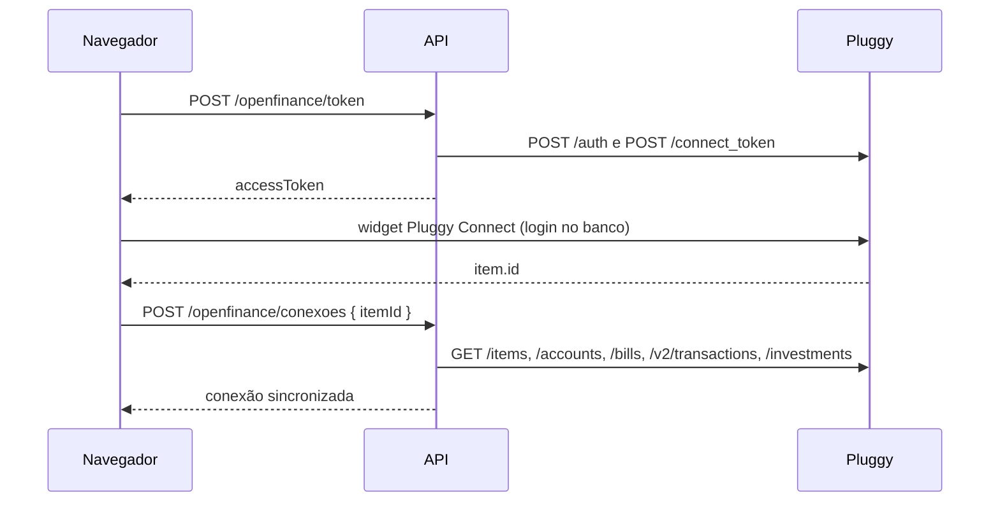

# Arquitetura

Como o Sistema Financeiro Pessoal é montado: contêineres, módulos, autenticação, modelo de dados, regras de saldo e fatura, e a integração com o Open Finance.

## Contêineres

| Contêiner | Imagem ou build | Função | Porta |
|---|---|---|---|
| `db` | `postgres:16-alpine` | Banco PostgreSQL | `127.0.0.1:DB_PORT` (padrão 5434) |
| `api` | build de `server/` | API HTTP (Node 20, Express 4, Prisma 5) | `127.0.0.1:API_PORT` (padrão 3092) |
| `web` | build de `client/` | Site estático no nginx, que encaminha `/api/` para a API | `WEB_PORT` (padrão 8092) |

Na subida, a API aplica o modelo de dados (`prisma db push`), e, se o banco estiver vazio, cria a conta do titular e as categorias padrão (`prisma/seed.ts`). Nenhum dado financeiro é criado.

## Módulos do servidor

`server/src/app.ts` carrega toda pasta de `server/src/modules/` que tenha um `routes.ts`. O `export default` de cada um é um roteador montado em `/api` com autenticação; `export const publico` é um roteador sem autenticação (login, saúde, identidade da tela de entrada).

| Módulo | Rotas |
|---|---|
| `auth` | login, saída, senha por e-mail |
| `cadastros` | usuários e Meu perfil |
| `contas` | contas e resumo do patrimônio |
| `transacoes` | lançamentos e categorias |
| `cartoes` | cartões, faturas e pagamento de fatura |
| `investimentos` | investimentos e movimentos |
| `planejamento` | orçamento e metas |
| `importacao` | leitura e gravação de fatura, extrato e planilha da B3; cotações |
| `openfinance` | credenciais da Pluggy, token do widget, conexões e sincronização |
| `painel` | resumo do painel, avisos do sino e busca |
| `plataforma` | identidade visual e e-mail |
| `logs` | log de atividades |

Código compartilhado em `server/src/lib/`: `erros.ts` (`HttpError`, `asyncHandler`, `validar` com zod), `auth.ts` (JWT), `cripto.ts` (AES-256-GCM para segredos no banco), `financas.ts` (datas, dinheiro, formatos de resposta e regras), `pluggy.ts` e `sincronizacao.ts`.

## Autenticação

Login por e-mail e senha (bcrypt) devolve um JWT de 12 horas, enviado em `Authorization: Bearer`. Há limite de tentativas de login. Só existe o perfil `TITULAR`: todos os usuários veem e alteram os mesmos dados, porque as finanças são da casa, não de cada usuário.

## Modelo de dados

Fonte da verdade: `server/prisma/schema.prisma`.

| Tabela | O que guarda |
|---|---|
| `Conta` | Contas (corrente, poupança, carteira, investimento) e cartões de crédito (`tipo = CARTAO`) |
| `Transacao` | Lançamentos. `valor` é sempre positivo; `tipo` diz se é `RECEITA` ou `DESPESA` |
| `Categoria` | Categorias de receita e de despesa |
| `Fatura` | Faturas de cartão, uma por vencimento |
| `Investimento`, `MovimentoInvestimento` | Posições e seus movimentos |
| `PosicaoPatrimonio` | Fotografia diária do patrimônio, para o gráfico do painel |
| `Orcamento`, `Meta` | Limite mensal por categoria e metas |
| `ConexaoBancaria` | Uma conexão do Open Finance (um "item" da Pluggy) |
| `Usuario`, `LogAtividade`, `ConfiguracaoPlataforma`, `TokenSenha`, `EmailEnviado` | Sistema |

Convenções:

- Dinheiro é `Decimal(14,2)` no banco e `number` na API.
- Datas "só dia" trafegam como `AAAA-MM-DD`; mês como `AAAA-MM`.
- `Conta.saldo` de um cartão é a dívida em aberto (positiva).
- Patrimônio = contas que não são cartão + investimentos − dívida dos cartões.
- `Transacao.transferencia = true` marca movimento entre contas próprias ou pagamento de fatura: fica fora de receitas, despesas e orçamento.
- `origem` é `MANUAL` ou `OPEN_FINANCE`.

## Regras de saldo e de fatura (registros manuais)

- Criar, alterar ou excluir um lançamento manual ajusta o saldo da conta na mesma transação do banco (`efeitoNoSaldo`): em conta comum, receita soma e despesa subtrai; em cartão, despesa aumenta a dívida.
- Compra no cartão entra na fatura do ciclo (`cicloDaFatura`): fecha neste mês se a compra foi até o dia de fechamento, senão no mês seguinte; vence no primeiro dia de vencimento depois do fechamento. A fatura é criada quando recebe a primeira compra e o total é refeito a cada mudança.
- Compra parcelada gera uma transação por mês; a última parcela absorve o resto do arredondamento.
- Pagar uma fatura a marca como paga, reduz a dívida do cartão e, se uma conta for indicada, lança nela a saída como transferência.
- As faturas mudam de situação sozinhas: aberta, fechada depois do fechamento, atrasada depois do vencimento.

## Importação de arquivos

O navegador abre o arquivo (`client/src/modules/importar/lerArquivo.ts`): CSV e OFX viram texto; o PDF vira texto com uma linha por linha da página (pdf.js); o XLSX vira uma matriz por aba. Só esse conteúdo vai para a API, em dois passos:

1. **Analisar** (`POST /importacao/analisar` ou `/importacao/b3/analisar`): interpreta e devolve uma prévia. Nada é gravado.
2. **Confirmar** (`POST /importacao/confirmar` ou `/importacao/b3/confirmar`): grava os itens que o usuário deixou marcados.

Fatura e extrato (`server/src/lib/importacao/extrato.ts`):

- O banco sai do nome do arquivo ou do texto; o vencimento sai do nome do arquivo, do texto do PDF ou, na falta, é estimado.
- CSV: o cabeçalho é a primeira linha com coluna de data e de valor; há leitura de parcela ("Parcela 2/5", "5 de 6").
- Em fatura, valor positivo é compra e negativo é pagamento ou estorno; o pagamento da fatura anterior entra como transferência.
- Compra parcelada que vem com a data original avança mês a mês até cair no ciclo da fatura.
- Cada lançamento recebe uma chave (`Transacao.chaveImportacao`, um hash de conta, data, descrição, valor e ordem): o que já existe é ignorado.
- Todos os lançamentos do arquivo vão para a fatura daquele vencimento; a dívida do cartão passa a ser a soma das faturas não pagas.
- O registro gravado é `MANUAL`: pode ser editado e recategorizado.

Planilha da B3 (`server/src/lib/importacao/b3.ts`):

- Movimentação: processa as linhas em ordem de data. "Transferência - Liquidação" é compra ou venda (custo médio); desdobro, bonificação, atualização, cisão e incorporação mudam a quantidade; rendimento, dividendo e JCP viram movimentos de rendimento. Direitos e recibos de subscrição ficam de fora.
- A quantidade de cada provento informa quantas cotas havia naquele dia: quando ela não bate com a conta, ou o ativo não tem evento há mais de um ano, a posição é marcada como suspeita.
- Posição: lê cada aba pelo nome das colunas.
- Os investimentos gravados são `MANUAL`, reconhecidos pelo código de negociação; os movimentos têm chave própria (`MovimentoInvestimento.chaveImportacao`).

Cotações (`server/src/lib/cotacoes.ts`): para cada investimento manual com código de bolsa e quantidade, busca o preço na brapi.dev e grava saldo = quantidade × preço. Roda ao importar a planilha, pelo botão e a cada 8 horas.

O histórico fica em `Importacao` (arquivo, tipo, banco, referência, quantos novos e repetidos).

## Open Finance (Pluggy)

- **Credenciais**: Client ID e Client Secret ficam em `ConfiguracaoPlataforma` (segredo cifrado) ou no `.env`. A chave de API da Pluggy vale 2 horas e fica em memória.
- **Widget**: o navegador abre o Pluggy Connect (`pluggy-connect-sdk`) com um token de 30 minutos criado no servidor. A senha do banco é digitada no widget; o sistema recebe só o id do item.
- **Importação** (`lib/sincronizacao.ts`): cada registro é reconhecido pelo id da Pluggy (`pluggyAccountId`, `pluggyBillId`, `pluggyTransactionId`, `pluggyInvestmentId`), então sincronizar de novo atualiza em vez de duplicar. A primeira carga busca 365 dias de lançamentos; as seguintes, 90.
- **Contas**: `BANK` vira corrente ou poupança; `CREDIT` vira cartão, com limite, bandeira e dias de fechamento e vencimento.
- **Faturas**: as fechadas vêm de `/bills`. A em aberto é montada com o saldo do cartão e a data de vencimento informada. Como a Pluggy não diz se a fatura foi paga, vale o pagamento registrado ou o vencimento já ter passado.
- **Lançamentos**: `DEBIT` vira despesa e `CREDIT` vira receita. A categoria da Pluggy é traduzida para uma categoria padrão quando há correspondência. Pagamento de fatura e movimento entre contas próprias entram como transferência.
- **Investimentos**: tipo e subtipo da Pluggy viram o tipo do sistema; o valor aplicado usa o valor original informado ou o saldo menos o lucro. Posição que deixa de vir é marcada como inativa.
- **O que é do usuário não é sobrescrito**: nome e cor da conta, nome do investimento, categoria, observação e marcação de transferência.
- **Quando sincroniza**: ao conectar, pelo botão, um minuto depois de o servidor subir e a cada 6 horas. Antes de ler, o servidor pede à Pluggy uma nova coleta e espera até 90 segundos.
- **Remover conexão**: apaga o item na Pluggy (revoga o consentimento) e apaga os dados importados, ou os mantém como manuais.

## Cliente

- Cada módulo é `client/src/modules/<modulo>/index.tsx` e exporta `rotas`; `App.tsx` junta tudo com `import.meta.glob`. O ícone da rota define o grupo do menu (`layout/grupos.ts`).
- Chamadas à API passam por `lib/api.ts` (prefixo `/api`, token, mensagem de erro). `useDados` busca e recarrega.
- Componentes em `ui/index.tsx` (página, tabela que vira cartões no celular, campos, modal, abas) e `ui/financas.tsx` (indicador, seletor de mês, valor colorido, barra de progresso, rosca).
- Cores, raios e sombras vêm de variáveis em `ui/estilo.css`, com valores para os temas claro e escuro. As cores primárias podem ser trocadas em Configurações.

## Log de atividades

Toda requisição autenticada é registrada (usuário, ação, módulo, caminho, status, IP), sem corpo, senha nem token. Registros com mais de 90 dias são apagados.
